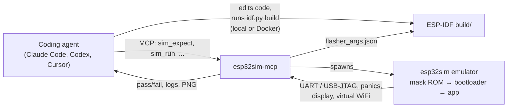

<div align="center">

# esp32sim-mcp

**Your agent writes ESP32 firmware, boots it and tests it. No board, no account.**

[](https://www.npmjs.com/package/esp32sim-mcp)
[](https://github.com/stramanu/esp32sim-mcp/actions/workflows/ci.yml)
[](LICENSE)
[](https://modelcontextprotocol.io)


<sub>Real, unedited session: Claude Code edits <code>hello_world</code>, builds it with ESP-IDF in Docker and checks the UART output in the emulator.</sub>

</div>

---

Coding agents are good at writing embedded C. They are blind when it comes to running it: without a board on the desk, "it compiles" is where the feedback loop ends.

**esp32sim-mcp** closes that loop. It gives Claude Code, Codex, Cursor or any MCP client a set of tools that boot the firmware the agent just built inside [esp32sim](https://github.com/mikroverk/esp32sim), a local instruction-level ESP32 emulator, and hand back what the chip printed, whether it crashed, and what was on the display. The agent reads the result, fixes the code and tries again, the way you would with a board on the bench.

- 🔌 **No hardware, no cloud.** Everything runs on your machine. No account, no token, no board.
- 🧬 **Real boot chain.** Espressif's mask ROM, the ESP-IDF bootloader and your unmodified app, on ESP32-S3, C3, C6 and the classic ESP32.
- 📡 **More than a console.** Virtual WiFi access point with DHCP, DNS and NAT, buttons, rotary encoder, GPIO, UART input, touch, and display screenshots.
- 🧪 **Assertions, not vibes.** `sim_expect` returns pass/fail and the exact line that is missing, so the agent knows what to fix.
- ⚡ **Fast.** Emulation usually runs ahead of real time: on Apple silicon, 8 emulated seconds of a WiFi station joining a network take about 0.6 s.
- 🤖 **Comes with a skill.** `init` installs an agent skill that teaches the write → build → simulate → fix loop, including building in Docker when ESP-IDF is not installed.

## Quickstart

```bash
npx -y esp32sim-mcp setup                      # emulator + mask ROMs, pinned and SHA-256 verified
cd your-esp-idf-project
npx -y esp32sim-mcp init                       # registers the MCP server and the skill for your agents
```

Then ask your agent for something you can see on the serial console:

> *Add a counter that prints once a second, build it, and check in the simulator that it reaches 5.*

Requirements: Node.js 22+, and ESP-IDF **or** Docker to build firmware. Prebuilt emulator binaries cover macOS (Apple silicon) and Linux (x64, arm64); see [other platforms](#other-platforms).

## What the agent sees

From a real session, the agent calls:

```json
{
  "tool": "sim_expect",
  "projectDir": ".",
  "chip": "s3",
  "board": "none",
  "maxSeconds": 10,
  "patterns": ["Hello world!", "Counter: 1", "Counter: 2", "Counter: 3", "Counter: 4", "Counter: 5"]
}
```

and gets back:

```text
### Expect Test: ✅ PASSED

Matched 6 / 6 patterns.

- ✅ Matched (line 54): `Hello world!`
- ✅ Matched (line 55): `Counter: 1`
  ...
- ✅ Matched (line 65): `Counter: 5`

#### Full UART Logs:
ESP-ROM:esp32s3-20210327
Build:Mar 27 2021
rst:0x1 (POWERON),boot:0xf (SPI_FAST_FLASH_BOOT)
...
```

When something goes wrong, it gets the panic instead (`Guru Meditation Error`, stack overflow, failed assert, heap corruption) with the log leading up to it, and the missing pattern spelled out.

## Tools

| Tool | What it does |
| --- | --- |
| `sim_run` | Boots the firmware and returns the console log, stop reason, emulated time and any panic. |
| `sim_expect` | Runs the firmware and asserts that strings or regexes appear on the console, in order by default. |
| `sim_script` | Drives the hardware at emulated timestamps: `press`/`release` buttons, `gpio` levels, `knob` turns, `uart`/`serial` input, `touch`, `stop`. |
| `sim_screenshot` | Returns a PNG of the board's display at a given emulated time. |
| `sim_list_boards` | Lists chips, boards, displays and inputs. |
| `sim_doctor` | Checks the emulator and ROMs and says how to fix what is missing. |

All tools take a `projectDir` (the ESP-IDF build is found through `build/flasher_args.json`) or explicit `appBin`/`bootloaderBin`/`ptableBin` paths, plus `chip`, `board` and `wifi` (e.g. `ssid=demo,psk=secret`). Both UART0 and the USB-Serial/JTAG console are captured, so output shows up whichever one the project logs to.

## How it works



esp32sim-mcp is a thin, tested layer: it finds the build, translates tool calls into esp32sim's command line, separates and de-duplicates the two consoles, detects panics, and shapes the result for an agent. The emulation itself is [esp32sim](https://github.com/mikroverk/esp32sim)'s work.

## Use it in CI

The same checks run without an agent, with exit code 0 on pass and 1 on fail. A GitHub Actions job that builds your firmware and asserts its boot log:

```yaml
jobs:
  firmware:
    runs-on: ubuntu-latest
    steps:
      - uses: actions/checkout@v5
      - uses: actions/setup-node@v5
        with:
          node-version: 22
      - name: Build
        run: docker run --rm -v "$PWD:/project" -w /project espressif/idf:v5.5.4 idf.py set-target esp32s3 build
      - name: Install the emulator
        run: npx -y esp32sim-mcp setup
      - name: Boot and check the console
        run: npx -y esp32sim-mcp expect --max-seconds 10 --pattern "app_main" "Counter: 5"
```

This is what this repository's own CI does with [`examples/hello-esp32`](examples/hello-esp32), including a scripted button press.

<details>
<summary><b>All CLI commands</b></summary>

```bash
esp32sim-mcp setup                 # install emulator + ROMs (or: install-emulator, fetch-roms)
esp32sim-mcp init [--global] [--agent claude-code|codex|cursor|claude-desktop] [--dry-run]
esp32sim-mcp run [-p dir] [--chip s3] [--board none] [--max-seconds 5] [--wifi ssid=x,psk=y]
esp32sim-mcp expect --pattern "a" "b" [--unordered] [--script actions.txt] [...run options]
esp32sim-mcp list [--chip c6]
esp32sim-mcp doctor
esp32sim-mcp serve                 # the MCP server (what agents launch)
```

</details>

## Supported chips and boards

| Chip | Boards (`board`) |
| --- | --- |
| ESP32-S3 | `atech14` (default: ST7735 TFT, buttons, rotary encoder, LED ring, audio), `waveshare-lcd4b` (480×480 touch), `waveshare-amoled18-v2` (368×448 AMOLED touch), `waveshare-cam` (OV5640 camera), `none` |
| ESP32-C3 | console only (no board models) |
| ESP32-C6 | `waveshare-c6-lcd147` (172×320 LCD), `none` |
| ESP32 (classic) | `ttgo-tdisplay` (135×240 TFT), `esp32dev-loopback`, `none` |

Use `none` for stock ESP-IDF projects. The virtual WiFi access point works on all four chips.

## Agent setup

`init` detects the agents you have and configures each one. It runs in your firmware project by default; `--global` writes user-level settings instead.

| Agent | MCP server (project / `--global`) | Skill (project / `--global`) |
| --- | --- | --- |
| Claude Code | `.mcp.json` / `claude mcp add --scope user` | `.claude/skills/` / `~/.claude/skills/` |
| Codex | `~/.codex/config.toml` (user only) | `.agents/skills/` / `~/.codex/skills/` |
| Cursor | `.cursor/mcp.json` / `~/.cursor/mcp.json` | `.cursor/skills/` / `~/.cursor/skills/` |
| Claude Desktop | `--global` only | — |

Existing entries are kept, reruns are no-ops, and a config file that does not parse is left untouched. For any other MCP client:

```json
{
  "mcpServers": {
    "esp32sim": { "command": "npx", "args": ["-y", "esp32sim-mcp", "serve"] }
  }
}
```

### Other platforms

`setup` installs prebuilt binaries on macOS arm64 and Linux x64/arm64. They are built from source by this repository's [emulator workflow](.github/workflows/emulator.yml) with signed build provenance (`gh attestation verify <archive> -R stramanu/esp32sim-mcp`). Elsewhere, build esp32sim with Cargo ([rustup](https://rustup.rs)), pinned to the commit this release is tested against:

```bash
cargo install --locked --git https://github.com/mikroverk/esp32sim --rev f535f3b42293a76ab64c231a0425f35857ab6cf1 esp32sim
npx esp32sim-mcp fetch-roms
```

`ESP32SIM_PATH` points at an emulator binary elsewhere and `ESP32SIM_ROM_DIR` at another ROM directory; ROMs inside an ESP-IDF install are found automatically.

## How it compares

| | Runs without a board | Needs an account or token | Built for agents |
| --- | :---: | :---: | :---: |
| **esp32sim-mcp** | ✅ local emulator | **No** | ✅ MCP server + skill |
| [Wokwi CLI MCP](https://docs.wokwi.com/wokwi-ci/mcp-support) | ✅ | Yes (`WOKWI_CLI_TOKEN`) | ⚠️ experimental |
| [esparagus](https://developer.espressif.com/blog/2026/08/esparagus-esp32-flashing-for-ci-and-agents/) (Espressif) | ❌ flashes real hardware | No | ✅ |
| [esp32sim](https://github.com/mikroverk/esp32sim) on its own | ✅ | No | ❌ CLI and web UI |

esparagus is the natural next step: simulate first with esp32sim-mcp, then confirm on a real board.

## Limitations

- An emulator is not silicon. Peripherals esp32sim does not model, RF timing and Bluetooth are out of reach here; confirm on hardware before you ship.
- The agent builds the firmware itself (`idf.py`, locally or in Docker); the MCP server does not compile.
- Windows is untested.

## Contributing

Issues and pull requests are welcome. See [CONTRIBUTING.md](CONTRIBUTING.md) for the development setup and how the end-to-end tests run against the real emulator, and [CHANGELOG.md](CHANGELOG.md) for what changed.

## Credits

- [esp32sim](https://github.com/mikroverk/esp32sim) by Joakim Eriksson, Alice and Mattia Fiumara: the emulator that does the real work (MIT).
- [Espressif](https://github.com/espressif): ESP-IDF and the mask ROM ELFs (Apache-2.0).
- [Model Context Protocol](https://modelcontextprotocol.io/).

## License

MIT © [Emanuele Strazzullo](https://github.com/stramanu)
